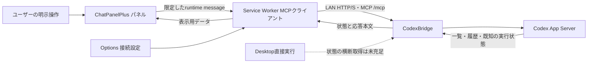

# CodexBridgeとのLAN内MCP連携 (#17)

- 文書ID: CPP-DESIGN-17
- 状態: 接続方式と不足能力の調査完了、機能実装は保留
- 確認日: 2026-11-07
- 関連: [Issue #17](https://github.com/weito-crowry/ChatPanelPlus/issues/17)、[TaskHub設計](18-taskhub-integration.md)、[手動作業中表示](14-codex-work-mode.md)

## 1. 判断と対象

**ChatPanelPlusのService Worker（SW）をMCPクライアントにする方式を優先する。** 既存の開始・履歴取得ツールを再利用できるため、専用HTTP APIの二重実装を避けられる。ただし、Desktopから直接実行したスレッドの実行状態、完全な最終本文、LAN認証には不足がある。これらを現行MCPの充足済み機能として扱わず、実装は保留とする。

対象は、実行中スレッドの一覧と状態、終了後の最後の応答本文、ユーザーの明示操作による開始・継続である。CodexBridge経由で作成したスレッドだけに限定しない。ChatGPT Webの自動送信・自動承認は扱わない。既存の手動「Codex作業中」表示は実稼働の観測とは別の状態として保持する。

## 2. 接続方式の比較

| 方式 | 利点 | 負担・限界 | 採否 |
| --- | --- | --- | --- |
| SWから既存Streamable HTTP MCPへ接続 | tool schemaと開始・履歴取得を再利用。ページDOMから認証情報を分離できる | session再接続、JSON/SSE両応答、SW停止復旧を実装する必要あり。Bridge能力不足は別途残る | 優先方式、機能実装は保留 |
| ChatPanelPlus専用の軽量HTTP API | UI向け応答を簡潔にできる | 開始・履歴・状態の二重実装。Desktop検出等の不足も自動では解消しない | 現段階では採用しない |
| TaskHub等の別クライアント経由 | 認証・監視を外部プロセスへ集約できる | TaskHubのAPI能力は未確認。配送と対応付けが増える | 将来比較案として保留 |

Content Scriptからの直接接続は優先しない。Content Scriptはページoriginの同一生成元制限を受け、拡張SWは対象の`host_permissions`を宣言した外部通信を行える。HTTPとHTTPSは別の権限指定である。[Chrome公式: Cross-origin network requests](https://developer.chrome.com/docs/extensions/develop/concepts/network-requests)

この資料だけで、ユーザーの通常ChromeからLAN内HTTP/HTTPSへの到達、Local Network Access、混在コンテンツ、CORS、証明書、プロキシの挙動を確認できたとはしない。SIWC経由も仕様・導入状態を確認していない。

## 3. 既存能力と必要な追加

外部コードは`D:/CodexBridge/src/codex_bridge/`を読み取り、HEAD `e8e003468bcc6dfd7ab5137ba776f54f07dfd5b1` を確認した。未コミット差分を含む可能性があるcheckoutの観測であり、稼働中サーバーのバージョンや設定の証明ではない。

| 要求 | 確認したツール・コード | 充足状況 |
| --- | --- | --- |
| 一覧とID | `codex_threads(thread_id=None, target_id=None, limit=20, cursor=None)` → `Bridge.threads()` → App Server `thread/list` | `allowed_roots`内のcwdで絞る。Bridge由来だけに限定するfilterはない。同じcatalogにDesktop作成threadがあれば一覧候補になるが、別プロセス実行の即時可視性は未検証 |
| 個別履歴 | `codex_threads(thread_id=..., include_history=True)` → `thread/read(includeTurns=True)` | 読取可能。ただし下記の切詰めがある。履歴読取ではBridgeのruntime状態を復元しない |
| 実行・終了・エラー | `codex_status(thread_id, turn_id?, activity_limit=20)` / `codex_wait(thread_id, turn_id, timeout_seconds?)` | Bridgeのメモリ内StateStore/ActivityStoreに既知のturnのみ。未知は`not_loaded`。Desktop別プロセスの状態をhydrateする実装ではない |
| Desktop直接実行検出 | Console内`CodexSessionScanner` / `ExternalThreadMonitor` | sessionログの開始/終端イベントを増分走査する既存実装あり。MCPへは未公開。originator=CodexBridge除外は作成元の推定で、現在の実行主体の保証ではない |
| 最後の応答本文 | statusの`latest_agent_message` / 履歴の`agentMessage` | statusは末尾16,000文字。履歴の汎用sanitizeは文字列末尾16,000・リスト先頭100・深さ制限。長い会話の最後/全文を取得できる保証がない |
| 新規開始・継続 | `codex_start(cwd, prompt, target_id?, model?, reasoning_effort?, sandbox_mode?, approvals_reviewer?, title?)` / `codex_continue(thread_id, prompt)` | 既存経路を再利用できる。continueは実際に新しいturnを開始するため、監視目的では呼ばない |
| 通信 | `server.py`のStreamable HTTP `/mcp` | Host/Origin許可設定はある。MCP経路のBearer認証は見当たらない。UI APIの`control_token`はMCP認証ではない |

コードの対応箇所は`server.py`の`codex_threads`/`codex_status`/`_transport_security`/`create_app`、`bridge.py`の`threads`/`status`/`_not_loaded_status`/`_sanitize_thread_history`、`state.py`の`update_latest_message`、`console/external_running_threads.py`である。

追加が必要な**API契約**は次の3点。以下は提案であり、存在するツール名ではない。既存ツールの拡張を先に検討し、別APIを必須にはしない。

1. **実行状態の再取得**: Desktop直接実行も含む`threadId`/`turnId`、状態、情報源、観測時刻、エラー、現在実行主体の不明を返す。Bridge再起動後も再照会でき、古いログからの推定をlive状態と区別する。
2. **最終応答の取得**: 最新の対象turnとfinalな応答itemを指定/解決し、本文、完結状態、切詰め有無、続きのcursorを返す。リスト先頭100件の返却を最終回答取得の代用にしない。
3. **明示開始の結果照会**: 応答喪失時に開始済みか照合できるrequest IDの意味論。現行start/continueにはこの冪等契約を確認できていない。

## 4. データフローと認証・権限

現行manifestの権限は`clipboardRead`、`storage`、`offscreen`で、LAN向け`host_permissions`はない。この文書では追加しない。実装案では設定されたLANホストとschemeを対象とし、Content Scriptから任意URLを代理fetchできるAPIを設けない。[Chrome公式の同資料](https://developer.chrome.com/docs/extensions/develop/concepts/network-requests)

LAN認証はIssue #17自身の要求である。提案は認証済みHTTP/S境界を再利用し、接続先・tokenをOptionsとSWで扱い、ChatGPT DOM・本文・診断ログへtokenを渡さない構成とする。現在のMCP Host/Origin検査は認証の代用にならず、MCP session IDもtokenとして扱わない。リプレイ、CSRF、漏えい時の失効、利用できる操作範囲をその認証境界で定義する。ネットワーク上の盗聴を防げない平文HTTPへtokenを流す構成を、保護済みとは記載しない。

MCP仕様はOrigin検証と認証を挙げている。ここではIssueで求められた認証設計を整理しており、既存の入力/手動作業中表示へ追加の確認ゲートを設けない。[MCP transport仕様 2025-06-18](https://modelcontextprotocol.io/specification/2025-06-18/basic/transports)

MCP公開面にはファイル/Git/approval等も存在するため、接続する認証境界でどの操作まで公開されるかを明示する。MVPのUIが呼ぶのは一覧・状態・履歴と、明示されたstart/continueのみ。既存のCodex承認設定を変更したり、承認を自動解決したりしない。認証サーバー/Bridgeの実装変更は別リポジトリの作業であり、本調査では行わない。

## 5. 切断、unknown、再起動、最終本文

接続状態（未接続/接続中/接続/再接続待ち）と実行状態を分離する。Bridge既知の`in_progress`、`needs_approval`、`needs_input`、`completed`、`interrupted`、`failed`を表示し、`not_loaded`や取得不能は`unknown`とする。切断でcompleted/failedへ確定せず、最後に観測した状態と時刻を残す。

SW停止/Bridge再起動/期限切れsessionでは再initializeし、一覧と選択threadを読取り直す。session失効応答で古いsessionを使い続けない。複数threadの状態は`targetId + threadId + turnId`で保持し、遅れて届いた旧turnの応答を新turnへ適用しない。読取は再試行できるが、start/continueの応答を失った場合は「開始結果不明」とし、同じ指示を自動再送しない。

Streamable HTTPクライアントはJSONとSSEの両応答を扱う。切断は取消を意味せず、再送/再開が重複してもthread/turn/item IDで表示を更新する。サーバーが再開を提供する場合だけevent IDから再開し、通知到達だけに完了検出を依存させない。[MCP transport仕様の応答・再開規則](https://modelcontextprotocol.io/specification/2025-06-18/basic/transports)

「最後の応答」は最新の対象turnの完結したfinal応答と定義する案とし、途中commentaryを最終回答と呼ばない。複数final itemの結合順とfinal分類の取得可否はBridge側契約に含める。interrupted/failedで残った本文は部分応答として表示する。切詰めがあればその旨を表示し、全文取得済みとしない。現在の`latest_agent_message`だけではこの定義を満たさない。

## 6. MVPと検証

MVP案は接続設定、一覧/選択、接続状態と実行状態、最終/部分応答の表示、指示文を伴う明示start/continueまで。監視はパネル表示時の更新を中心にし、常時SSEやSWの永続稼働を前提としない。更新間隔は実測前に固定しない。上記3つのAPI契約とネットワーク認証の不足は残件として実装へ引き継ぐ。

| 検証 | 期待結果 | 今回の結果 |
| --- | --- | --- |
| 通常ChromeからLAN HTTP/S、CORS、host_permissions、LNA、証明書 | 選んだ経路の通信可否と必要設定を実測 | 未確認 |
| Desktop作成/直接実行とBridge作成の混在 | 一覧、実行主体、状態、unknownを正しく区別 | 未確認 |
| 完了/失敗/中断/承認待ち、長文・100turn超の履歴 | 最新turnのfinal/部分本文を欠落と区別 | 未確認 |
| SW停止、Bridge再起動、session失効、切断中の完了 | 再接続で再照会し、二重開始しない | 未確認 |
| 複数thread、遅延応答、再生成 | 別thread/turnの状態や本文が混線しない | 未確認 |
| token、無認証/異origin、許可外操作 | 認証境界どおりに処理し、秘密をDOM/ログへ出さない | 未確認 |

Chrome操作はユーザーの通常プロファイルで手動実施する。[統合確認表](../manual-verification-2026-11-07.md)と[Composer互換性調査](../investigations/2026-11-07-composer-compatibility.md)の既存入力・通知の確認も併せて行う。今回行ったのはコードと一次資料の読取り、設計文書作成であり、接続試験や外部リポジトリの実装ではない。
