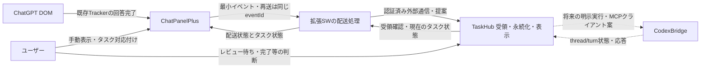

# TaskHubとの状態連携 (#10)

- 文書ID: CPP-DESIGN-18
- 状態: 責務・データフローの設計案、外部API未確認、未実装
- 確認日: 2026-11-07
- 関連: [Issue #10](https://github.com/weito-crowry/ChatPanelPlus/issues/10)、[CodexBridge連携](17-codexbridge-mcp.md)、[手動作業中表示](14-codex-work-mode.md)

## 1. 現在の実装と判断

ChatPanelPlusにはTaskHubクライアントも外部向け`host_permissions`もない。回答完了は`ConversationStatisticsController`のTrackerから通知され、視覚表示と音声へ独立して渡る。手動作業中表示は`CodexWorkModeController`と既存repositoryが管理する。**回答完了はタスク完了の証明ではなく、手動作業中ON/OFFはCodex実稼働状態ではない。**

ローカルの`taskhub-workflow/SKILL.md`にはタスク作成→`in_progress`→検証コメント→レビュー待ち、およびAPI利用の運用だけがある。TaskHubのイベント受信API、認証、永続化、依存関係、冪等性、監視/再試行の実装は確認していない。以下は実装済み機能の説明ではなく、必要な契約の提案である。TaskHubの既存APIに合わせて調整し、存在しないendpoint名を確定しない。

最初のMVPは、状態イベントの受領・表示と明示的なタスク対応付けに絞る。レビュー開始・レビュー待ちへの遷移・完了・次のCodex指示は人間が決める。既存の通知に対応するだけでTaskHubの状態を勝手に確定しない。

## 2. 責務とデータフロー

| 責務 | 担当案 | 既存/提案の区分 |
| --- | --- | --- |
| 回答完了の検出、手動作業中表示 | ChatPanelPlus | 既存 |
| event ID生成、配送と配送失敗表示 | ChatPanelPlus SW | 提案 |
| タスク、イベント受領記録、依存関係、レビュー状態 | TaskHub | 責務案。実API/保存モデルは未確認 |
| レビュー判断、対応タスク選択、次の指示 | ユーザー | Issueに従う人間の判断 |
| Codexの開始・継続・実行状態 | CodexBridge | 既存能力と不足は#17参照。TaskHubからの接続は未実装 |

TaskHubをMCPクライアントにする将来案は、TaskHubが監視を所有する場合に採用する。#17の拡張からの直接実行も併用するなら、実行ごとに所有者を一つにし、同じタスク指示を両方から二重開始しない。

## 3. 最小イベントと識別

イベントには本文・Markdown・クリップボード・認証情報を含めない。以下をversion 1の契約案とする。

| フィールド | 意味・必要性 |
| --- | --- |
| `version` / `eventId` | envelope版とイベントUUID。再試行時に再生成しない |
| `kind` | `answer-completed` または `manual-work-mode-changed` |
| `occurredAt` | 観測時刻。順序確定には単独で使わない |
| `sourceInstanceId` / `sequence` | 同一送信元内の順序・重複検出。browser session/拡張再起動での寿命を定義する |
| `conversationId` / `tabSessionId` | 会話とタブ内表示の区別。タブ再利用で旧状態と混同しない |
| `messageId` / `turnKey` | 回答完了を再照合する場合の識別。既存Trackerで得られたものだけ |
| `enabled` | 手動表示変更のみ。trueを実稼働と解釈しない |
| `taskId` | ユーザーが明示対応付けした場合のみ。名称/会話タイトルの推測一致で決めない |

`sourceInstanceId`等は新規契約案で、現在の保存schemaに存在するものではない。会話IDとタブ識別も外部送信するメタデータとして扱い、設定/エクスポートの説明へ明記する。対応付けは`taskId`とChatGPT会話/タブの組を管理し、Codex連携を行う段階で`targetId + threadId + turnId`を追加する。TaskHub task IDとCodex thread IDを同じIDとして扱わない。

## 4. 冪等性、再試行、レビュー待ち

TaskHub側には`eventId`単位での受領一意性と、受領済みか照合できる応答を求める。同一回答を別タブが観測した場合のタスク表示は、`conversationId + messageId`等で同じ完了事実へまとめる案とする。手動作業中変更はタブ単位の別状態なので同じ方法で合算しない。実際の受領APIがこれを満たすかは未確認。

配送失敗時は同じ`eventId`で間隔を広げて再送し、オフラインからの復帰やSW再起動後に配送待ちを再開する。これにはメモリだけに置かない最小outboxが必要で、既存設定/統計の保存キーとは分離する案とする。再試行回数・保持期間・容量はTaskHubの応答仕様と実測に合わせて決め、無期限に増やさない。受領確認後にoutboxから除去する。認証失敗やschema不一致は連続再送せず、その理由と手動再試行の状態を表示する。

TaskHubが受領したことと、タスクがレビュー待ちになったことは別である。`answer-completed`はタイムライン上の事実として表示し、検証結果や必要作業の充足を含まない。人間がレビュー待ちへ送る操作をしたときに、TaskHubの実際の状態名とrevisionへ合わせて更新する。同時更新の競合は配送成功として隠さず、最新状態を再表示する。OFFイベントでタスクを失敗/完了へ動かしたり、TaskHub状態で手動toggleを一方的に上書きしたりしない。

## 5. 通信・認証と通信なしの案

HTTP連携する場合は、Content Scriptから限定したextension messageを送り、SWが設定先だけへ通信する案とする。接続先、token、権限範囲はTaskHubの既存方式を確認して再利用する。現行manifestへこの文書だけで権限を追加しない。拡張SWの外部通信には対象hostの権限が必要で、Content Scriptへ同じ特権が付与されるわけではない。[Chrome公式: Cross-origin network requests](https://developer.chrome.com/docs/extensions/develop/concepts/network-requests)

認証/権限境界はIssue #10の要求を満たす設計対象であり、既存の入力操作に新たな承認ゲートを加えない。TaskHubとCodexBridgeのtokenをChatGPT DOMへ出さず、ログにも残さない。TaskHub→Bridgeには既存認証済み経路の利用可否を確認し、#17に記したMCP認証の不足を「既存認証あり」とみなさない。

外部通信なしの比較案は、状態の手動転記、または最小イベントのローカル書き出しをユーザーがTaskHubへ渡す方式である。追加のhost権限が不要な代わりに即時同期・自動再試行はできない。書き出しも現在は未実装。MVPの採否はTaskHub APIの確認後に判断し、連携未設定時も既存●通知・音・手動表示を単独で使える構成にする。

## 6. 実装段階と確認項目

1. **設計段階（今回）**: 責務・イベント契約・状態の違い・未確認能力を記録する。
2. **MVP案**: 接続設定、明示タスク対応付け、イベント受領表示、配送待ち/失敗/受領済み、再配送。TaskHub状態の自動遷移はしない。
3. **将来段階**: TaskHub側MCPクライアント、Codex thread対応付け、ユーザーが指示する処理開始。#17の不足と#9の適用条件を別途解決する。

| 確認項目 | 期待結果 | 現在 |
| --- | --- | --- |
| TaskHubの接続URL/schema/認証/状態名 | 既存API資料で契約を確定 | 未確認 |
| 同一event再送、二重タブ、応答喪失 | イベントと状態が重複増加しない | 未確認 |
| オフライン、SW再起動、容量/保存失敗 | 既存通知を妨げず配送状態を示す | 未確認 |
| route変更、同名task、タブID再利用 | 明示した対応先だけへ記録する | 未確認 |
| 完了/手動OFF/遅延イベント | レビュー待ちやタスク完了を勝手に確定しない | 未確認 |
| TaskHubと#17双方の開始操作 | 同一指示の二重実行が起きない | 未確認 |
| 通常ChromeのLAN通信、必要権限 | 選択経路の可否・設定を実測する | 未確認 |

ユーザー通常Chromeの手動確認は[統合確認表](../manual-verification-2026-11-07.md)へ記録する。[Composer互換性調査](../investigations/2026-11-07-composer-compatibility.md)の既存入力・通知も回帰対象。今回はTaskHub通信、API呼出し、データ作成、外部repoの変更をしていない。
